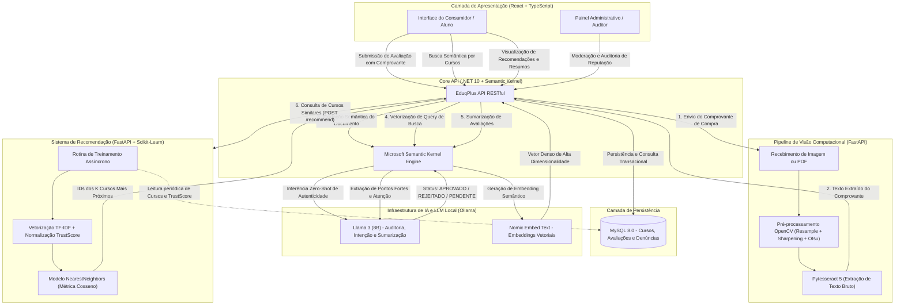

# Eduq+ 🚀

O **Eduq+** é uma plataforma independente de avaliação e transparência de infoprodutos. O ecossistema é projetado para empoderar consumidores no mercado de cursos online por meio de avaliações auditadas com comprovantes, denúncias estruturadas e análise automatizada via Inteligência Artificial integrada de forma local.

Projeto acadêmico (2026).

## 👥 Integrantes da Equipe
1. Victor Augusto Farias Ferreira
2. Felipe Alexandre Pereira
3. Lucas Barroso Silvestrini
4. Gustavo Felipe Bento Lopes

## 📖 Descrição Detalhada do Projeto
O Eduq+ atua como um portal de auditoria para combater o charlatanismo digital no mercado de cursos online. A plataforma cruza promessas de páginas de vendas com a percepção real dos alunos, calculando um *TrustScore* dos produtos. Para garantir a veracidade das avaliações, o sistema exige a submissão de comprovantes de consumo do curso (como boletos e certificados), os quais passam por um rigoroso processo de validação utilizando Visão Computacional. Além disso, inteligência artificial é empregada de forma ampla no ecossistema para estruturar dados, buscar intenções e recomendar cursos similares com base em filtragem de conteúdo, com um algoritmo de Classificação KNN.

## 🖼️ Pipeline de Processamento de Imagens
O módulo de processamento atua na validação automatizada de comprovantes de compra e certificados submetidos pelos alunos. O fluxo segue as seguintes etapas integradas no microsserviço (`ocr_service`):

1. **Aquisição e Rasterização (Multi-formato):** Suporte a imagens (`.jpg`, `.jpeg`, `.png`) decodificadas via OpenCV (`imdecode`) e documentos `.pdf` rasterizados em alta resolução (300 DPI) via PyMuPDF (`fitz`).
2. **Reamostragem Espacial (Scale-Up 2x):** Redimensionamento por interpolação bicúbica (`INTER_CUBIC`) para aumentar a densidade amostral de glifos finos ou documentos de baixa resolução.
3. **Conversão de Cor e Realce Espacial:** Conversão de BGR para escala de cinza e aplicação de filtragem espacial de nitidez (*sharpening*) com kernel Laplaciano composto $3 \times 3$ (ganho de altas frequências) para acentuar o contraste das bordas dos caracteres.
4. **Segmentação por Limiarização de Otsu:** Binarização global estatística automática (`THRESH_BINARY + THRESH_OTSU`), separando fundo e texto através da maximização da variância inter-classes.
5. **Pós-processamento Morfológico:** Aplicação de operação morfológica para controle de conectividade dos traços tipográficos.
6. **Reconhecimento Óptico de Caracteres (OCR):** Extração de texto bruto via Tesseract 5 (`pytesseract`, modelo LSTM em português, `--psm 6`).
7. **Auditoria Semântica por IA:** O texto extraído é submetido ao agente Llama 3 (via Semantic Kernel / Ollama) para validação contra o curso correspondente, classificando o comprovante em `APROVADO` (concede selo de Compra Verificada), `REJEITADO` ou `PENDENTE` (encaminhado para moderação administrativa manual).

## 🤖 Integração com a Disciplina de IA e Pipeline Completo do Projeto

O Eduq+ integra Inteligência Artificial de ponta a ponta na sua arquitetura, combinando **Machine Learning Clássico** (filtragem baseada em conteúdo e cálculo de similaridade vetorial) e **Inteligência Artificial Generativa / LLMs locais** (processamento de linguagem natural, embeddings densos e classificação semântica).

### Pipeline Completo do Projeto (Fim a Fim)

O fluxo integrado entre os serviços da plataforma, o pipeline de visão computacional e os modelos de IA opera da seguinte forma:



### Componentes e Papel da IA no Projeto:

1. **Recomendação Baseada em Conteúdo (TF-IDF + KNN):**
   - O microsserviço dedicado `recommendation_service` processa periodicamente o catálogo de cursos armazenado no banco de dados relacional.
   - Aplica `TfidfVectorizer` (com remoção de stopwords em língua portuguesa) sobre títulos e descrições técnicas, acoplando a matriz de termos ao vetor normalizado de `TrustScore` (reputação auditada).
   - Treina em memória um modelo `NearestNeighbors` utilizando métrica de distância por cosseno, calculando em tempo real os $k$ cursos mais correlacionados e confiáveis para exibição ao usuário via endpoint `/recommend/`.

2. **Auditoria Automatizada de Documentos (Visão Computacional + LLM):**
   - Imagens e PDFs de certificados e comprovantes de matrícula passam pelas 7 etapas do pipeline de visão computacional (`ocr_service`).
   - O texto bruto resultante é submetido ao modelo `Llama 3` via `Semantic Kernel`, que atua como classificador de conformidade para atestar a autenticidade da relação entre aluno e curso, concedendo de forma autônoma o selo de "Compra Verificada".

3. **Busca Semântica e Classificação de Intenção:**
   - As consultas textuais dos usuários são analisadas pelo `Llama 3` para detecção de intenção de busca por qualidade/confiança vs. busca temática pura.
   - Embeddings densos gerados pelo modelo `nomic-embed-text` viabilizam busca vetorial conceitual por aproximação de cosseno (ex.: pesquisar por *"banco de dados corporativo performático"* encontra cursos de arquitetura e SQL mesmo sem exata correspondência textual).

4. **Sumarização Analítica de Reputação:**
   - Avaliações dispersas de estudantes são consolidadas em tempo real pelo `Llama 3`, gerando sínteses estruturadas com pontos fortes e pontos de atenção para tomada ágil de decisão pelo consumidor.

---

## 📊 Dataset Utilizado no Projeto

> [!NOTE]
> **Observação sobre Datasets:** Este projeto **NÃO utiliza datasets externos, estáticos ou pré-coletados** (como bases do Kaggle, Hugging Face ou arquivos CSV/JSON congelados de terceiros).

### Justificativa da Escolha:
1. **Natureza Transacional do Sistema:** O Eduq+ é concebido como uma plataforma viva de auditoria descentralizada. Os dados de cursos, avaliações, denúncias e comprovantes são gerados e manipulados dinamicamente pelas interações dos usuários e administradores na base relacional MySQL.
2. **Data Seeder Automatizado para Demonstração:** Para viabilizar testes, validação da banca e demonstração prática imediata de todas as funcionalidades de IA sem dependências externas, o backend conta com um mecanismo embutido de **Data Seeder** ([`backend/Eduq+.API/Data/DbInitializer.cs`](file:///c:/Users/WinUser/Eduq+/backend/Eduq+.API/Data/DbInitializer.cs)). Ao subir os contêineres Docker, o sistema popula automaticamente o banco de dados com uma massa de dados demonstrativa estruturada (cursos de diferentes categorias, avaliações realistas e métricas de reputação).
3. **Treinamento e Inferência Dinâmicos:**
   - O modelo de Machine Learning (`recommendation_service`) treina assincronamente a partir das entidades persistidas diretamente no banco de dados (`SELECT Id, Titulo, DescricaoOriginal, TrustScore FROM Curso`).
   - Os modelos neurais generativos e de representação vetorial (`Llama 3` e `nomic-embed-text`) operam via inferência *zero-shot* e geração de embeddings em tempo de execução, dispensando a necessidade de bases supervisionadas prévias para fine-tuning.

---

## 📋 Arquivos de Requisitos (Requirements)

As dependências de software do ecossistema encontram-se estruturadas por microsserviço e camada de aplicação:

### 1. Serviço de Visão Computacional e OCR (`ocr_service/requirements.txt`)
Contém os módulos Python necessários para o processamento de imagens, rasterização de PDFs e extração de caracteres:
* Arquivo: [`ocr_service/requirements.txt`](file:///c:/Users/WinUser/Eduq+/ocr_service/requirements.txt)
  - `fastapi` e `uvicorn`: API assíncrona de alto desempenho.
  - `opencv-python-headless`: Manipulação e filtros matemáticos de imagem sem dependência de interface gráfica.
  - `pytesseract`: Interface com o motor de OCR Tesseract 5.
  - `pymupdf`: Rasterização em alta resolução (300 DPI) de comprovantes em formato PDF.
  - `numpy`: Operações matriciais de imagem e kernels de convolução.
  - `python-multipart` e `python-dotenv`: Gerenciamento de variáveis de ambiente e uploads de arquivos multipart.

### 2. Serviço de Recomendação e Machine Learning (`recommendation_service/requirements.txt`)
Contém os pacotes de Ciência de Dados e Machine Learning responsáveis pelo cálculo de similaridade e treinamento do KNN:
* Arquivo: [`recommendation_service/requirements.txt`](file:///c:/Users/WinUser/Eduq+/recommendation_service/requirements.txt)
  - `scikit-learn`: Implementação do `TfidfVectorizer` e do algoritmo `NearestNeighbors`.
  - `numpy`: Manipulação de matrizes e normalização do `TrustScore`.
  - `pymysql`: Conexão com o banco relacional MySQL para ingestão da base de treino.
  - `fastapi`, `uvicorn`, `pydantic`: Servidor REST e validação de esquemas de entrada/saída.

### 3. Demais Componentes do Sistema
* **Backend (.NET 10 / C#):** Gerenciado via manifesto de pacotes NuGet em [`backend/Eduq+.API/EduqPlus.API.csproj`](file:///c:/Users/WinUser/Eduq+/backend/Eduq+.API/EduqPlus.API.csproj) (Entity Framework Core, Microsoft Semantic Kernel, Pomelo MySQL).
* **Frontend (React / TypeScript):** Gerenciado via [`frontend/package.json`](file:///c:/Users/WinUser/Eduq+/frontend/package.json) (React 19, TypeScript, Vite, React Router 7, Material UI / MUI com Emotion e Axios).

#### Instalação Manual das Dependências Python (Opcional - caso execute sem Docker):
```bash
# Serviço de Visão Computacional / OCR
cd ocr_service
python -m venv venv
venv\Scripts\activate      # No Windows (ou source venv/bin/activate no Linux/macOS)
pip install -r requirements.txt

# Serviço de Recomendação (KNN)
cd ../recommendation_service
python -m venv venv
venv\Scripts\activate      # No Windows (ou source venv/bin/activate no Linux/macOS)
pip install -r requirements.txt
```

---

## 🛠️ Stack Tecnológica

Seguindo a modelagem de serviços conteinerizados e a arquitetura cliente-servidor descrita na documentação técnica:

* **Camada de Apresentação:** React + TypeScript (SPA) com Material UI (MUI)
* **Camada de Aplicação (API):** C# ASP.NET Core (.NET 10), Entity Framework Core e Microsoft Semantic Kernel
* **Camada de Visão Computacional:** Python 3.11 (FastAPI, OpenCV, PyTesseract, PyMuPDF)
* **Camada de LLM:** Ollama local (Llama 3 para auditoria de comprovantes e consolidação de reputação; Nomic Embed Text para representação vetorial)
* **Camada de Machine Learning:** Recomendação de cursos por similaridade de conteúdo (TF-IDF + K-Nearest Neighbors) via microsserviço Python dedicado (`recommendation_service`)
* **Camada de Dados (BD):** MySQL 8.0
* **Infraestrutura:** Docker & Docker Compose

## 📦 Como Instalar e Executar a Infraestrutura

Graças à conteinerização total da arquitetura via Docker, você não precisa instalar compiladores, runtimes ou servidores de banco de dados locais em sua máquina hospedeira.

### Pré-requisitos

* [Git](https://git-scm.com) instalado.
* [Docker Desktop](https://www.docker.com/products/docker-desktop/) rodando ativamente na máquina.

### Passos de Inicialização (Primeira Instalação ou Inicialização)

Para garantir que o banco de dados seja criado corretamente e a Inteligência Artificial provisionada sem falhas de sincronia na primeira execução, siga o fluxo limpo abaixo:

1. Clone o repositório do projeto para a sua máquina.

2. Configure o seu arquivo `docker-compose.yml` seguindo o `docker-compose.yml.example`

3. Abra o terminal na pasta raiz do repositório clonado `...\Eduq+` (onde está o arquivo `docker-compose.yml`).
 
4. **Limpeza de Segurança:** Garanta que não há volumes ou contêineres residuais bloqueando o banco de dados rodando o comando:
   ```bash
   docker compose down -v
   ```
   
5. Subir a Infraestrutura: Execute o comando de orquestração abaixo para construir e subir todos os serviços em segundo plano:
   ```bash
   docker compose up -d --build
   ```

6. Aguardar o Processamento da IA (Data Seeder): O backend iniciará a inserção de dados de testes e a geração local dos embeddings semânticos em segundo plano. Aguarde de 60 a 90 segundos antes de acessar o sistema pela primeira vez para garantir que todos os cursos e avaliações estejam perfeitamente sincronizados no banco de dados.

## 🔗 Portas e Endereços Disponíveis

Após a inicialização bem-sucedida de todos os contêineres, os serviços estarão acessíveis através dos seguintes mapeamentos de portas:

* **Interface Web do Usuário (Frontend):** `http://localhost:5173`
* **API RESTful (Backend):** `http://localhost:5292` *(Documentação Swagger: `http://localhost:5292/swagger`)*
* **Serviço de Visão Computacional (OCR API):** `http://localhost:8000` *(Documentação Swagger: `http://localhost:8000/docs`)*
* **Serviço de Recomendação (RecSys API):** `http://localhost:8001` *(Documentação Swagger: `http://localhost:8001/docs`)*
* **Banco de Dados (MySQL):** `localhost:3306`
* **Serviço de IA (Ollama API):** `http://localhost:11434`

*Nota:* O backend aplica as migrations do Entity Framework Core e executa automaticamente o **DbInitializer (Data Seeder)** na primeira inicialização, populando o banco com a massa de dados para testes imediatos.

---

## 👥 Cenários Disponíveis para Teste de Permissões

A massa de dados inserida automaticamente no banco configura as contas abaixo para simular as permissões mapeadas nos diagramas de casos de uso do sistema:

| Perfil / Ator | E-mail de Acesso | Senha Padrão | Funcionalidades Demonstráveis no Cenário |
| --- | --- | --- | --- |
| **Administrador / Auditor** | `admin@eduqplus.com` | `Admin123` | Validação de comprovantes de compra, execução de auditoria técnica cruzando promessas da página de vendas e moderação de denúncias .|
| **Usuário Ativo / Consumidor** | `carlos.ativo@gmail.com` | `User123` | Demonstrar controle de propriedade. Ele possui cursos cadastrados, avaliações escritas por ele e denúncias ativas (botões de edição e exclusão aparecem apenas para o dono do registro). |
| **Usuário Limpo** | `mariana.limpa@gmail.com` | `User123` | Experiência limpa de um novo estudante ingressando na plataforma do zero. |

---

## 🧠 Validação Prática dos Recursos de IA

1. **Busca Semântica por Intenção:** Vá ao catálogo de cursos e pesquise por conceitos abstratos como *"banco de dados corporativo performático"* ou *"ganhos reais corrigidos pela inflação"*. Os embeddings gerados localmente pela IA farão o cruzamento semântico aproximado mesmo que nenhuma palavra exata conste nos títulos.
2. **Resumo Inteligente de Reputação:** Abra o curso *"Formação Avançada em C#"* ou *"Masterclass de IA e Engenharia de Prompt com Python"*. A seção superior exibirá um painel contendo a consolidação automatizada feita pela IA dividida entre "Resumo Geral", "Pontos Fortes" e "Pontos de Atenção" capturados com base nas avaliações reais submetidas no portal.
3. **Auditoria Automatizada de Comprovantes (Visão Computacional + Llama 3):** Faça login com uma conta de consumidor (ex.: `carlos.ativo@gmail.com`), acesse a página de detalhes de um curso e clique em *"Avaliar Curso"*. Preencha as notas e envie um comprovante em formato de imagem (`.jpg`, `.png`) ou documento `.pdf`. O sistema executará o pipeline de Visão Computacional (`ocr_service`) e submeterá o texto extraído ao `Llama 3`, concedendo de forma autônoma o selo de *"Compra Verificada"* na avaliação.
4. **Recomendação Inteligente de Cursos (TF-IDF + KNN):** Ao registrar uma avaliação com nota alta (média $\ge 4.0$), o frontend aciona em segundo plano o microsserviço de recomendação e exibe automaticamente um carrossel interativo (`RecomendacoesCarrosselDialog`) com os $k$ cursos mais similares baseados em proximidade textual e índice *TrustScore*. As consultas contam com cache em memória no backend (`IMemoryCache`) e consultas em lote para resposta com baixa latência.

---

## 💡 Experiência de Uso e Funcionalidades Recentes

* **Identificadores Amigáveis (#):** Todas as tabelas e listagens de dados (como produtores, categorias e denúncias) exibem numeração sequencial simplificada (`#1`, `#2`, etc.) para agilidade visual, mantendo o identificador único (GUID) do banco acessível com um toque/cursor sobre o elemento (Tooltip).
* **Gerenciamento de Sessão Isolado:** A autenticação utiliza `sessionStorage`, inicializando o frontend deslogado por padrão. Isso permite testar e alternar facilmente entre as diferentes personas (Administrador, Usuário Ativo com registros criados e Novo Usuário limpo) sem resíduos de autenticação.
